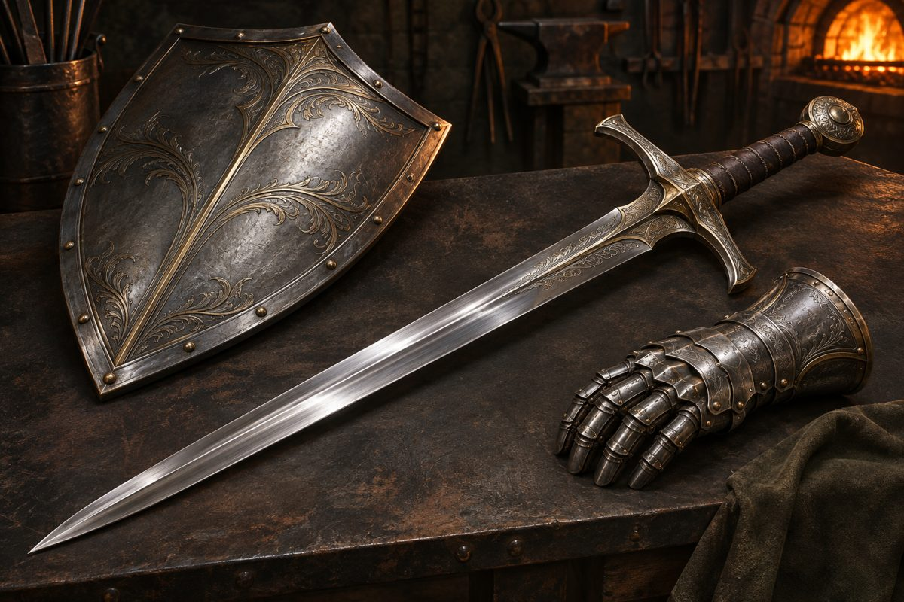

[日本語](README.md) | **English**

# GearForge

**A kit for forging 3D weapons, armor, and items with an AI agent — from a reference image, a category, or a single sentence.**
It runs on Tripo's image-to-3D generation and solves "I can't write prompts" by *breaking your idea into fields you can tweak*.



> **Note:** The app UI and the agent instructions (Skills) are currently in Japanese. On-screen labels are given below as English (日本語).

---

## Contents
- [What it does](#what-it-does)
- [How it flows](#how-it-flows)
- [Requirements](#requirements)
- [Getting started (5 min)](#getting-started-5-min)
- [Screens](#screens)
- [Handing off to the agent](#handing-off-to-the-agent)
- [How it works](#how-it-works)
- [World settings (world.json)](#world-settings-worldjson)
- [What's in the kit](#whats-in-the-kit)
- [FAQ](#faq)
- [Troubleshooting](#troubleshooting)
- [Roadmap](#roadmap)
- [License](#license)

---

## What it does

| Input | Example |
|---|---|
| **Reference image** | Game screenshots, illustrations, photos of real objects |
| **Category × taste** | "katana × Japanese", "hammer × steampunk" from dropdowns |
| **Text** | "a hammer shaped like a tuna", "a rusty pirate cutlass" |

↓

| Output | |
|---|---|
| **GLB** (PBR textures) | Ready for Unity / Unreal / Blender / the web |
| FBX / STL | Converted automatically with headless Blender (if installed) |

You only **look, choose, fix**, and **paste one line to the agent**.
Image generation, Tripo operation, and file handling are done by the agent (Codex / Claude Code).

---

## How it flows

```
 Materials ─▶ Blueprint ─▶ Design ─▶ Forging ─▶ Delivery
 give input   tweak 6      pick 1    spin and    save the
              fields       of 4      pick a 3D   GLB
```

| Stage | You (in the app) | The smith = agent |
|---|---|---|
| **Materials (素材庫)** | Drop images / pick category and taste / write one line | Reads the input and splits it into 6 fields: type, shape, material, ornament, mood, condition |
| **Blueprint (設計図)** | Edit only the lines you don't like, then approve | Turns it into an English prompt and draws 4 concept images |
| **Design (意匠)** | Click one | Generates 3D candidates in Tripo from that image (2 by default) |
| **Forging (鍛造)** | Drag to rotate candidates, pick one | Exports the chosen one to `exports/` |
| **Delivery (納品)** | Download | — |

At the end of each stage the app shows a one-line instruction for the smith. Paste it into your agent; when the work is done, the app moves on by itself.

---

## Requirements

| | For | Notes |
|---|---|---|
| **Node.js 22+** | Running the app | No `npm install` (zero dependencies) |
| **Chromium-based browser** | Opening the app | Chrome / Edge |
| **Codex** or **Claude Code** | The agent doing the work | Codex has built-in image generation. Claude Code needs another tool for the concept-image stage only |
| **Tripo account** | 3D generation | Uses Tripo Studio in your logged-in browser. No API key needed (`TRIPO_API_KEY` enables the optional API route) |
| Blender (optional) | FBX / STL export | Runs headless automatically. Without it you get GLB only |
| Reference images you may use | Optional | PNG / JPEG / WebP |

Tripo runs on your own account and credits (about 55 credits per model, measured Nov 2026 with H3.1 best quality).
No account yet? → **[Sign up for Tripo](https://tripo.pxf.io/jR7AM5)** (referral link; the price is the same for you)

---

## Getting started (5 min)

```bash
git clone https://github.com/saitama-dxs/gearforge.git
cd gearforge
```

**Launch**: double-click `start.bat` (Windows) or `start.command` (Mac) in the folder — **http://127.0.0.1:8767** opens in your browser. From a terminal: `npm start` (Linux: `./start.sh`). Close the window or press Ctrl+C to stop.
Requires Node.js 22+ (the launcher tells you if it is missing). If macOS blocks it the first time, right-click → Open. To use another port, add it: `start.bat 8790`.

In another window, start your agent in the same folder.

```bash
# Codex CLI
codex
# or Claude Code
claude
```

Tell it once:

```
Read AGENTS.md. I want to start making weapons with this kit. The app is already running.
```

Then create a project with "+ New (＋ 新しい一振り)" in the app and follow the screens.

---

## Screens

### Materials (素材庫)
Pick a **World setting (世界設定, optional)** to align era, taste, art style, and colors with that world (see [World settings](#world-settings-worldjson)).
Choose an input method with the tabs:
- **From reference images (参考画像から)** — drop one or more images. Use the notes field for overrides like "slimmer"
- **Pick category and taste (種別とテイストを選ぶ)** — weapons / armor / items × 3 eras × 13 tastes (classic, dark, Japanese, Chinese, Norse, steampunk, military, tactical, retro-future, cyberpunk, organic, cartoon, low-poly)
- **Describe in text (テキストで伝える)** — one line in the notes field

### Blueprint (設計図)
The 6 fields (type, shape, material, ornament, mood, condition) are listed. **Rewrite only the lines you want and click Approve (承認).**
"Redraw (引き直してもらう)" restarts the breakdown.

### Design (意匠)
Four concepts appear. Click one → "Forge with this design (この意匠で鍛造する)". **Tripo credits are spent from here.** The agent tells you the count and estimate before running.

### Forging (鍛造)
Rotate the 3D candidates in the browser and pick one. "Reforge (打ち直させる)" generates more with different settings.

### Delivery (納品)
Download the finished files. "Forge another (もう一振り鍛える)" starts the next project.

---

## Handing off to the agent

The instruction is always this one line:

```
gearforge begin <project-name> <stage>
```

| Entry point | How |
|---|---|
| **Codex (ChatGPT desktop app)** | Codex in the left menu → open the folder → paste. Built-in image generation and browser control make this the easiest |
| **Codex CLI** | `cd gearforge && codex` → paste |
| **Claude Code** | `cd gearforge && claude` → paste. Works the same via `CLAUDE.md`. Only concept-image generation needs another tool or manual work |

The agent runs `node scripts/project.mjs next <name>` to get just a few lines — current stage, inputs, which Skill to read — then reads that one Skill and works. It does not read the whole project file, the log, or this README (to save tokens).
**Choosing candidates and approving prompts is always done by a person; the agent stops at every checkpoint.**

---

## How it works

```
┌──────────────┐  read/write  ┌──────────────────────┐  read/write  ┌──────────────┐
│ Local app    │ ◀──────────▶ │ projects/<name>/      │ ◀──────────▶ │ Agent        │
│ server.mjs   │   fs.watch   │   project.gearforge   │  scripts/    │ Codex /      │
│ public/      │   → SSE      │   inputs/ concepts/   │  project.mjs │ Claude Code  │
└──────────────┘              │   models/ exports/    │              └──────┬───────┘
                              └──────────────────────┘                     │
                                     image generation / Tripo Studio (browser) + collect.mjs / export.mjs (Blender)
```

- The app and the agent **never talk directly**. They share one JSON file, `project.gearforge`
- The app watches `projects/` with `fs.watch` and pushes changes to the browser over SSE
- The agent never edits the JSON by hand — only through `scripts/project.mjs`. The log lives separately in `log.jsonl` to keep the state file small
- Tripo is operated in Studio in your logged-in browser. **The kit itself needs no API key and costs nothing**
- Browser state is checked as text — no screenshots and no watching the generation. `scripts/collect.mjs` picks up the GLB from your Downloads folder
- Format conversion runs in headless Blender (`scripts/export.mjs`). The agent generally doesn't look at images
- LLM-agnostic: Codex and Claude Code use the same instruction and the same Skills

See [`docs/design.md`](docs/design.md) (Japanese) for the schema.

---

## World settings (world.json)

Use this when you want several pieces of gear to share one look. The format is shared across the Forge series kits.

```bash
node scripts/world.mjs new my-world worlds/my-world.json   # create a template
node scripts/world.mjs validate worlds/my-world.json       # check it
node scripts/world.mjs lock worlds/my-world.json           # see the fixed English text appended to image prompts
```

- Era, taste, and art style use values from `public/catalog.json`
- Palette colors must have English names (they go into prompts)
- `worlds/examples/ashen-kingdom.json` is an example. Put your own world.json in `worlds/` and it appears in the app (git-ignored)

---

## What's in the kit

```
gearforge/
├─ AGENTS.md / CLAUDE.md     Agent entry point (stages and rules)
├─ server.mjs                Local app (zero dependencies, 127.0.0.1:8767)
├─ public/                   UI (index.html / app.js / style.css / catalog.json)
├─ scripts/project.mjs       Project CLI (next/summary/apply/done and more)
├─ scripts/collect.mjs       Picks up and registers GLBs downloaded from Studio
├─ scripts/world.mjs         world.json validation and style lock (synced from forge-core)
├─ worlds/                   world.json files (ships examples/ and world.schema.json)
├─ scripts/tripo.mjs         Tripo API route (optional, with TRIPO_API_KEY)
├─ scripts/export.mjs        Export (GLB copy + FBX/STL via headless Blender)
├─ skills/
│   ├─ gear-prompt-decompose/    Input → 6 fields (3 modes)
│   ├─ gear-concept-image/       English prompt + 4 concept images
│   ├─ tripo-gear-generate/      3D candidates in Tripo Studio (API as fallback)
│   └─ gear-export/              Export
├─ projects/<name>/          Your work (git-ignored)
│   ├─ project.gearforge  log.jsonl
│   ├─ inputs/ concepts/ models/ exports/ _trash/
└─ docs/design.md            Design notes and schema
```

### `scripts/project.mjs` cheat sheet

```bash
node scripts/project.mjs next gear-01          # what to do now (a few lines)
node scripts/project.mjs summary gear-01       # counts and recent log
echo '{"prompt":{"type":"katana"}}' | node scripts/project.mjs apply gear-01 -
node scripts/project.mjs done gear-01 prompt "prompt breakdown created"
node scripts/collect.mjs gear-01 start m1=<taskId> m2=<taskId>
node scripts/collect.mjs gear-01 m1      # pick up from Downloads
node scripts/collect.mjs gear-01 finish
node scripts/export.mjs gear-01 glb,fbx,stl
node scripts/project.mjs init gear-01
node scripts/project.mjs get gear-01 [prompt.type]
node scripts/project.mjs set gear-01 prompt.material "black iron and gold"
node scripts/project.mjs stage gear-01 concept
node scripts/project.mjs add-concept gear-01 c1 concepts/c1.png "<prompt>"
node scripts/project.mjs add-model gear-01 m1 models/m1.glb models/m1.png tripo-studio <taskId>
node scripts/project.mjs select gear-01 model m1
node scripts/project.mjs log gear-01 "what was done"
```

---

## FAQ

**Q. Do I need an image to start?**
No. "Category and taste" or "Text" alone works.

**Q. Can I write "in the style of <some title>"?**
The agent never passes titles straight into prompts. It translates them into components — color tone, material, ornament, era (a rule in `gear-prompt-decompose`).

**Q. When are Tripo credits spent?**
After you pick a design, click "Forge", and hand the instruction to the agent. The agent tells you the count and estimate first. Default is 2 models.

**Q. Can I paste my API key into the chat?**
Please don't; the agent never asks. Normally no key is needed (Studio is used). Only if you want the API route, set the `TRIPO_API_KEY` environment variable.

**Q. Can Claude Code do everything?**
Blueprint, forging, and delivery, yes. For concept images Claude Code alone can't generate images — let Codex do it, or make 4 images with another tool, put them in `concepts/`, and register them with `add-concept`.

**Q. Things other than weapons (armor, small items)?**
Supported in the presets. Anything that works as a single mesh follows the same flow.

---

## Troubleshooting

| Symptom | Fix |
|---|---|
| The screen doesn't switch | Keep the app open. Check the log (footer) for `stage -> …`; if it's there, reload |
| The agent doesn't proceed | Did you **send** the instruction in the chat (copying alone does nothing)? |
| Cut off during generation | Don't regenerate. Reopen the task in Studio's history using `m1=<taskId>` from the log, then Export → GLB → `collect.mjs` |
| `新しい .glb が無い` (no new .glb) | Your browser saves downloads elsewhere. Rerun with `GEARFORGE_DOWNLOADS=<folder>` |
| Upload to Tripo stalls | On Windows, pass an absolute path with forward slashes like `E:/...` to the file chooser |
| No FBX / STL | Blender wasn't found. Set `BLENDER` to the Blender executable path |
| `Debugger unattached` | The browser connection dropped. Reopen Studio in a new tab |
| Candidates come out with multiple items, hands, or a stand | Ask for a redraw with "one item, plain background, side view" (`concept redo`) |
| Port 8767 is in use | `start.bat 8790` (Mac: `./start.sh 8790`; terminal: `PORT=8790 npm start`) |

---

## Roadmap

- [ ] Sparks animation while forging; a field to engrave a name on delivery
- [ ] A mode where "Next" sends directly to Claude Code / Codex (no copy-paste)
- [ ] `.claude/skills/` layout for Claude Code and an alternative for image generation
- [ ] Armor fitted to a body
- [ ] Stronger prompt templates for Japanese gear (katana, naginata, shuriken)
- [ ] English UI

---

## License

To be decided (source-available under consideration).
For now, please contact us before redistributing or embedding.

Made by Saitama DX Solutions · uses [Tripo](https://www.tripo3d.ai/)
