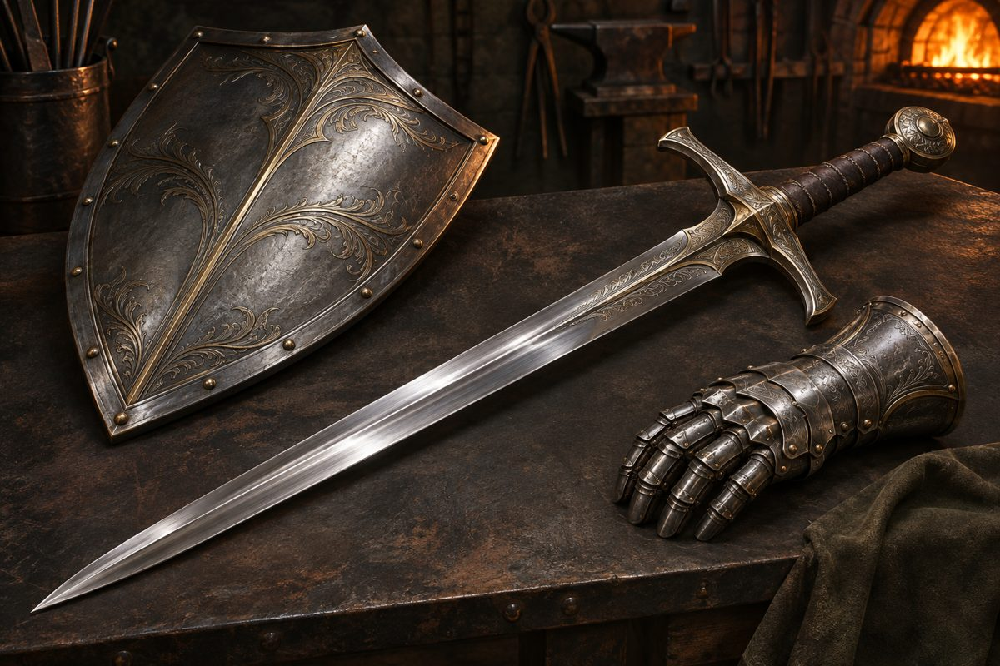

**日本語** | [English](README.en.md)

# GearForge / 装備精錬所

**参考画像・種別・ひとことから、AIエージェントと分担して武器・防具・アイテムの3Dモデルを鍛えるキット。**
Tripo の画像→3D生成を使い、「プロンプトが書けない」を *項目分解＋手直し* で解決します。




---

## 目次
- [何ができるか](#何ができるか)
- [どんなふうに進むか](#どんなふうに進むか)
- [必要なもの](#必要なもの)
- [はじめかた（5分）](#はじめかた5分)
- [画面の説明](#画面の説明)
- [エージェントへの渡し方](#エージェントへの渡し方)
- [仕組み](#仕組み)
- [キットの中身](#キットの中身)
- [よくある質問](#よくある質問)
- [トラブルシューティング](#トラブルシューティング)
- [ロードマップ](#ロードマップ)
- [ライセンス](#ライセンス)

---

## 何ができるか

| 入力 | 例 |
|---|---|
| **参考画像** | ゲームのスクショ、イラスト、実物の写真 |
| **種別 × テイスト** | 「刀 × 和風」「ハンマー × スチームパンク」をプルダウンで |
| **テキスト** | 「マグロの形をしたハンマー」「錆びた海賊のカトラス」 |

↓

| 出力 | |
|---|---|
| **GLB**（PBRテクスチャ付き） | Unity / Unreal / Blender / Web にそのまま |
| FBX / STL | Blender（ヘッドレス）で自動変換。Blender が無ければ GLB のみ |

人がやるのは **見る・選ぶ・直す** と **指示書のコピペ** だけ。
画像生成・Tripo操作・ファイル整理はエージェント（Codex / Claude Code）が行います。

---

## どんなふうに進むか

```
 素材庫 ──▶ 設計図 ──▶ 意匠 ──▶ 鍛造 ──▶ 納品
 入力する   6項目を    4案から   3D候補を   GLBを
           手直し     1つ選ぶ   回して選ぶ 保存
```

| 工程 | あなた（アプリ） | 鍛冶師＝エージェント |
|---|---|---|
| **素材庫** | 画像を置く／種別とテイストを選ぶ／一言書く | 入力を読み、種別・形状・素材・装飾・雰囲気・状態の6項目に分解 |
| **設計図** | 気に入らない行だけ日本語で直して承認 | 英語プロンプトに変換し、概念画像を4案描く |
| **意匠** | 1枚クリック | 選ばれた画像で Tripo の3D候補を生成（既定2本） |
| **鍛造** | 候補をドラッグで回して1つ選ぶ | 選ばれた候補を `exports/` に書き出し |
| **納品** | ダウンロード | — |

各工程の終わりに「鍛冶師への指示書」が出ます。コピーしてエージェントに貼ると作業が始まり、終わると炉の表示が勝手に進みます。

---

## 必要なもの

| | 用途 | 備考 |
|---|---|---|
| **Node.js 22 以上** | アプリの起動 | `npm install` 不要（依存ゼロ） |
| **Chromium系ブラウザー** | アプリを開く | Chrome / Edge |
| **Codex** または **Claude Code** | 作業担当のエージェント | 画像生成は Codex 内蔵。Claude Code は意匠（画像）工程のみ別手段が必要 |
| **Tripo のアカウント** | 3D生成 | ログイン済みブラウザーの Tripo Studio を使う。APIキーは不要（`TRIPO_API_KEY` があれば API 経路も選べる） |
| Blender（任意） | FBX / STL 書き出し | ヘッドレスで自動実行。無ければ GLB のみ |
| 自分が使ってよい参考画像 | 任意 | PNG / JPEG / WebP |

Tripo はユーザー自身のアカウント・クレジットで動きます（1本あたり約55クレジット、2026-11時点の実測。H3.1 最高品質）。
アカウントがまだの方 → **[Tripoに登録する](https://tripo.pxf.io/jR7AM5)**（紹介リンク。登録しても料金は変わりません）

---

## はじめかた（5分）

```bash
git clone https://github.com/saitama-dxs/gearforge.git
cd gearforge
```

**起動**：フォルダーの `start.bat`（Windows）か `start.command`（Mac）をダブルクリックすると、ブラウザーで **http://127.0.0.1:8767** が開きます。端末からは `npm start`（Linux は `./start.sh`）。止めるときはウィンドウを閉じるか Ctrl+C。
Node.js 22 以上が必要です（足りなければ起動時に案内が出ます）。Mac で初回に止められたら、右クリック →「開く」。ポートを変えるときは `start.bat 8790` のように番号を付けます。

別ウィンドウでエージェントを同じフォルダで起動します。

```bash
# Codex CLI
codex
# または Claude Code
claude
```

最初に一度だけ、こう伝えます。

```
AGENTS.md を読んで、このキットで武器の制作を始めたい。アプリはもう起動している。
```

あとはアプリの「＋ 新規」でプロジェクトを作り、画面の指示どおりに進めてください。

---

## 画面の説明

### 素材庫
**世界設定（任意）** を選ぶと、時代・テイスト・画風・配色がその世界にそろいます（下の「世界設定（world.json）」）。
上のタブで入力方法を選びます。
- **参考画像から** — 画像を1枚以上ドロップ。補足欄は「もっと細身に」など上書き指示に使う
- **種別とテイストを選ぶ** — 武器・防具・アイテム × 時代3種 × テイスト13種（王道／ダーク／和風／中華風／北欧／スチームパンク／ミリタリー／タクティカル／レトロフューチャー／サイバーパンク／バイオ／カートゥーン／ローポリ）
- **テキストで伝える** — 補足欄に一言

### 設計図
6項目（種別・形状・素材・装飾・雰囲気・状態）が日本語で並びます。**直したい行だけ書き換えて「承認」**。
「引き直してもらう」で分解からやり直せます。

### 意匠
4案が並びます。1枚クリック → 「この意匠で鍛造する」。ここから **Tripo のクレジットを消費** します。エージェントは本数と概算を伝えてから実行します。

### 鍛造
3D候補をブラウザ上で回して見比べ、1つ選びます。「打ち直させる」で設定を変えて追加生成。

### 納品
完成 GLB をダウンロード。「もう一振り鍛える」で次のプロジェクトへ。

---

## エージェントへの渡し方

指示書は常にこの1行です。

```
gearforge begin <プロジェクト名> <工程>
```

| 入口 | やり方 |
|---|---|
| **Codex（ChatGPTデスクトップアプリ）** | 左メニュー Codex → フォルダを開く → 入力欄に貼る。画像生成・ブラウザー操作が内蔵なので一番楽 |
| **Codex CLI** | `cd gearforge && codex` → 貼る |
| **Claude Code** | `cd gearforge && claude` → 貼る。`CLAUDE.md` から同じ手順で動く。意匠工程の画像生成だけ別ツールか手動 |

エージェントは `node scripts/project.mjs next <名前>` で「今の工程・入力・読むSkill」を数行だけ受け取り、その Skill 1つを読んで作業します。プロジェクト全体やログ、README は読みません（トークン節約）。
**候補の選択とプロンプトの承認は必ず人が行い、エージェントは確認地点で止まります。**

---

## 仕組み

```
┌──────────────┐   読む/書く   ┌──────────────────────┐   読む/書く   ┌──────────────┐
│ ローカルアプリ │ ◀──────────▶ │ projects/<name>/      │ ◀──────────▶ │ エージェント  │
│ server.mjs   │   fs.watch    │   project.gearforge   │  scripts/    │ Codex /      │
│ public/      │   → SSE       │   inputs/ concepts/   │  project.mjs │ Claude Code  │
└──────────────┘               │   models/ exports/    │              └──────┬───────┘
                               └──────────────────────┘                     │
                                                     画像生成 / Tripo Studio（ブラウザー）＋ collect.mjs / export.mjs（Blender）
```

- アプリとエージェントは **直接通信しない**。`project.gearforge`（JSON 1ファイル）だけを共有する
- アプリは `projects/` を `fs.watch` で監視し、変更を SSE でブラウザーへ通知して画面を切り替える
- エージェントは JSON を手で触らず、`scripts/project.mjs` 経由でのみ更新する。ログは `log.jsonl` に分けて、状態ファイルを小さく保つ
- Tripo はユーザーのログイン済みブラウザーで Studio を操作する。**キット側に APIキーもコストも発生しない**
- ブラウザー操作はテキストで状態を確認し、スクリーンショットや生成待ちの見張りをしない。GLB の回収は `scripts/collect.mjs` がダウンロードフォルダから行う
- 形式変換はヘッドレスの Blender（`scripts/export.mjs`）。エージェントは画像も原則見ない
- LLM 非依存。Codex でも Claude Code でも同じ指示書・同じ Skill で動く

スキーマは [`docs/design.md`](docs/design.md) を参照。

---

## 世界設定（world.json）

複数の装備を同じテイストでそろえたいときに使います。Forge シリーズの他のキットとも共通の形式です。

```bash
node scripts/world.mjs new my-world worlds/my-world.json   # 雛形を作る
node scripts/world.mjs validate worlds/my-world.json       # 検査
node scripts/world.mjs lock worlds/my-world.json           # 画像プロンプトに付く英語の固定文を確認
```

- 時代（era）・テイスト（taste）・画風（artStyle）は `public/catalog.json` の値から選びます
- 配色（palette）は英語の色名を必ず書きます（プロンプトに入るため）
- `worlds/examples/ashen-kingdom.json` が例です。自分の world.json は `worlds/` に置けば画面に出ます（gitignore 対象）

---

## キットの中身

```
gearforge/
├─ AGENTS.md / CLAUDE.md     エージェントの入口（工程表・ルール）
├─ server.mjs                ローカルアプリ（依存ゼロ、127.0.0.1:8767）
├─ public/                   画面（index.html / app.js / style.css / forge-detailed.png）
├─ scripts/project.mjs       プロジェクトCLI（next/summary/apply/done ほか）
├─ scripts/collect.mjs       Studio で落とした GLB を回収・登録
├─ scripts/world.mjs         world.json の検証・画風ロック文（forge-core から同期）
├─ worlds/                   world.json（examples/ と world.schema.json を同梱）
├─ scripts/tripo.mjs         Tripo API 経路（任意。TRIPO_API_KEY がある場合）
├─ scripts/export.mjs        書き出し（GLB コピー＋Blender ヘッドレスで FBX/STL）
├─ skills/
│   ├─ gear-prompt-decompose/    入力→6項目分解（3モード）
│   ├─ gear-concept-image/       英語化＋概念画像4案
│   ├─ tripo-gear-generate/      Tripo Studio で3D候補（API は予備）
│   └─ gear-export/              書き出し
├─ projects/<name>/          制作物（gitignore）
│   ├─ project.gearforge  log.jsonl
│   ├─ inputs/ concepts/ models/ exports/ _trash/
└─ docs/design.md            設計メモ・スキーマ
```

### `scripts/project.mjs` 早見

```bash
node scripts/project.mjs next gear-01          # 今やること（数行）
node scripts/project.mjs summary gear-01       # 件数と直近ログ
echo '{"prompt":{"type":"刀"}}' | node scripts/project.mjs apply gear-01 -
node scripts/project.mjs done gear-01 prompt "分解プロンプト作成"
node scripts/collect.mjs gear-01 start m1=<taskId> m2=<taskId>
node scripts/collect.mjs gear-01 m1      # ダウンロードフォルダから回収
node scripts/collect.mjs gear-01 finish
node scripts/export.mjs gear-01 glb,fbx,stl
node scripts/project.mjs init gear-01
node scripts/project.mjs get gear-01 [prompt.type]
node scripts/project.mjs set gear-01 prompt.material "黒鉄と金"
node scripts/project.mjs stage gear-01 concept
node scripts/project.mjs add-concept gear-01 c1 concepts/c1.png "<prompt>"
node scripts/project.mjs add-model gear-01 m1 models/m1.glb models/m1.png tripo-studio <taskId>
node scripts/project.mjs select gear-01 model m1
node scripts/project.mjs log gear-01 "何をしたか"
```

---

## よくある質問

**Q. 画像がないと始められない？**
いいえ。「種別とテイスト」か「テキスト」だけでも進めます。

**Q. 「〇〇（作品名）風」と書いていい？**
エージェントが作品名をそのままプロンプトに流すことはありません。色調・素材・装飾・時代といった構成要素に翻訳します（`gear-prompt-decompose` のルール）。

**Q. Tripo のクレジットはいつ減る？**
意匠を選んで「鍛造する」を押し、指示書をエージェントに渡した後です。エージェントは本数と概算を先に伝えます。既定は2本。

**Q. APIキーをチャットに貼っていい？**
貼らないでください。エージェントも聞きません。通常は APIキー不要（Studio を使う）。API を使いたい場合だけ環境変数 `TRIPO_API_KEY` に入れてください。

**Q. Claude Code で全部できる？**
設計図・鍛造・納品はできます。意匠（概念画像）だけは Claude Code 単体で画像生成ができないため、Codex に任せるか、別の画像生成ツールで4枚作って `concepts/` に置き `add-concept` で登録してください。

**Q. 武器以外（鎧、小物）は？**
プリセットで選べます。単一メッシュで成り立つものなら同じ流れで動きます。

---

## トラブルシューティング

| 症状 | 対処 |
|---|---|
| 画面が切り替わらない | アプリを開いたままにしていますか。ログ（フッター）に `stage -> …` が出ているか確認。出ていればリロード |
| エージェントが先に進まない | 指示書をチャットに**送信**しましたか（コピーだけでは動きません） |
| 生成中に切れた | 生成し直さない。ログの `m1=<taskId>` で Studio の履歴から開き直し、Export → GLB → `collect.mjs` |
| `新しい .glb が無い` | ブラウザーのダウンロード先が既定と違う。`GEARFORGE_DOWNLOADS=<フォルダ>` を付けて再実行 |
| Tripo のアップロードで止まる | Windows ではファイル選択に `E:/...` のようなスラッシュ区切り絶対パスを渡すと通る |
| FBX / STL が出ない | Blender が見つからない。環境変数 `BLENDER` に実行ファイルのパスを入れる |
| `Debugger unattached` | ブラウザー接続切れ。新しいタブで Studio を開き直す |
| 候補が複数本・手・台座つきで出る | 意匠を「1本だけ・無地背景・横向き」に描き直させる（`concept redo`） |
| 8767 番が使用中 | `start.bat 8790`（Mac は `./start.sh 8790`、端末なら `PORT=8790 npm start`） |

---

## ロードマップ

- [ ] 鍛造中の火花アニメーション、納品時に「銘」を刻む欄
- [ ] 「次へ」から Claude Code / Codex へ直接投げるモード（コピペ不要）
- [ ] Claude Code 用 `.claude/skills/` 配置と画像生成の代替手段
- [ ] 防具の着装整合（人体に合わせる）
- [ ] 和風装備（刀・薙刀・手裏剣）のプロンプトテンプレ強化
- [ ] 英語 UI

---

## ライセンス

未定（source-available を検討中）。
現時点では再配布・組み込みの前にご相談ください。

Made by さいたまDXソリューション · uses [Tripo](https://www.tripo3d.ai/)
